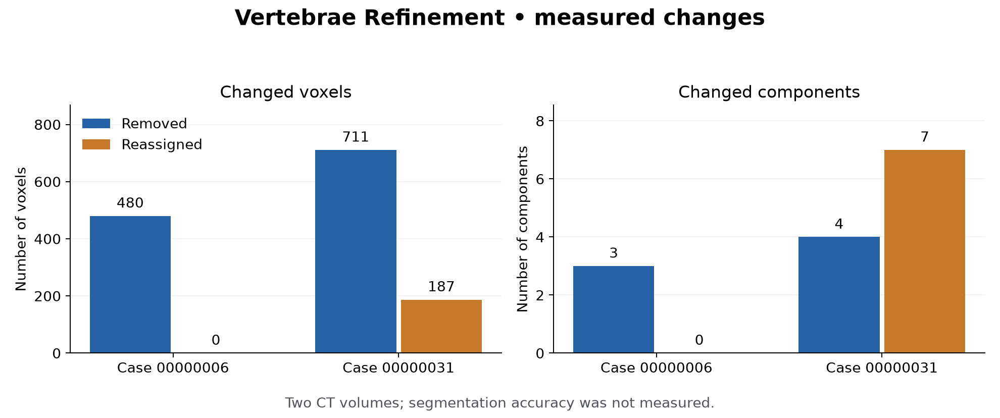

# Vertebrae Refinement

[](docs/results.md)

Automatic postprocessing for vertebra segmentation masks: identify small components far from their assigned vertebra, then remove them or assign them to a supported neighboring label.

The project includes a standalone NIfTI processor, CT overlay review, tests, a reproducible baseline runner, and measured results from two CT volumes. It uses an existing SuPreM/SwinUNETR model for baseline predictions; the contribution here is the postprocessing and verification workflow.



## Results

| Case | Components changed | Voxels removed | Voxels reassigned |
|---|---:|---:|---:|
| BDMAP_00000006 | 3 | 480 | 0 |
| BDMAP_00000031 | 11 | 711 | 187 |
| **Total** | **14** | **1,191** | **187** |

Both output volumes retained the original CT shape and affine. All 48 individual binary masks matched their respective combined label maps. No background voxels were converted into foreground.

**These are counts of changes, not accuracy scores.** No vertebra reference annotations were available for these cases, so Dice, sensitivity, and accuracy improvements were not measured. The method leaves boundary errors, missing bone, and nearby wrong labels unresolved. See [the result record](docs/results.md) and [machine-readable verification](results/verification.json).

## Method

1. Find the largest 26-connected component for each vertebra label.
2. Select a secondary component only if it contains at most 10% as many voxels and is more than 50 mm from the main component.
3. Measure distances in world coordinates using the full NIfTI affine.
4. Reassign the component only if it touches exactly one plausible retained label whose main component is within 20 mm. Otherwise remove it.
5. Export a combined label map, all 24 binary masks, and a JSON record of every change.

Nearby fragments and substantial secondary components remain intact. Contact decisions are made before applying relabeling, avoiding dependence on label processing order. [Method details](docs/method.md) describe the assumptions and failure cases.

## Run locally

The recorded local checks used Python 3.14. Dependencies support Python 3.11 or later; validation on the other versions is pending.

```bash
python -m venv .venv
# Windows: .venv\Scripts\activate
# Linux/macOS: source .venv/bin/activate
python -m pip install -r requirements.txt
python postprocessing_vertebrae.py --input predictions_baseline --output predictions_refined
```

Each input case directory must contain `combined_labels.nii.gz`, a 3D integer volume with labels 0–24. Label 0 is background; labels 1–24 run from L5 to C1. Use a separate output directory to preserve the baseline.

```text
predictions_refined/
  case_id/
    combined_labels.nii.gz
    postprocessing_report.json
    segmentations/
      vertebrae_L5.nii.gz
      ...
      vertebrae_C1.nii.gz
```

For CT overlays and component measurements:

```bash
python review_predictions.py --ct-root ct_volumes --predictions predictions_refined --output review
```

To run the tests:

```bash
python -m pip install -r requirements-dev.txt
python -m pytest tests -q
```

The [GitHub Actions workflow](https://github.com/habib-analyst/vertebrae-refinement/actions/workflows/tests.yml) is included. A successful hosted run has not yet been recorded; the test evidence reported here comes from local execution.

To verify refined outputs against the CTs, baseline masks, and change reports:

```bash
python -m scripts.verify_predictions --ct-root ct_volumes --baseline predictions_baseline --predictions predictions_refined --output results/verification.json
python scripts/summarize_results.py --predictions predictions_refined --output results
```

Run verification with normal Python execution; do not use `python -O`, which disables assertion checks.

## Reproduce the baseline

[`scripts/kaggle_baseline.py`](scripts/kaggle_baseline.py) runs the pinned upstream inference code in a separate Python 3.10 environment on Kaggle. Enable a GPU and Internet before running it. It downloads the upstream demo and checkpoint, checks checkpoint loading, runs inference, and verifies the output geometry and binary masks. [Reproduction instructions](docs/reproduction.md) record versions and input hashes.

The repository publishes code and numerical result summaries. CT scans, model weights, medical-image figures, and prediction archives must be obtained or generated separately under their applicable terms.

## Sources and license

Baseline model and inference: [SuPreM](https://github.com/MrGiovanni/SuPreM/tree/7583213147e33daf2031cc0a3ad30faa516f4f64). Demo source: [AbdomenAtlas](https://github.com/MrGiovanni/AbdomenAtlas).

Original code in this repository is MIT licensed. Upstream code, checkpoints, and datasets retain their own licenses; the MIT license does not grant rights to them. See [THIRD_PARTY.md](THIRD_PARTY.md).

Maintained by [Habib Ur Rehman](https://github.com/habib-analyst).
